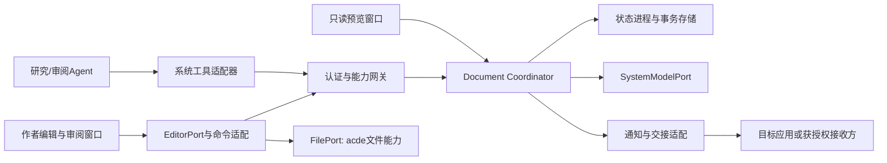

# MarkText for Dopame OS — Agent 协作版技术设计

- 状态：设计提案 v0.1，待实现
- 日期：2026-11-15
- 对应需求：[prd.md](prd.md)
- 基线：develop 已提交版本 `de57d278`；当前编辑器修复工作区需先冻结为经过 G0 验收的提交

## 1. 架构决策

| 决策              | 选择                                                            | 原因                                                        |
| ----------------- | --------------------------------------------------------------- | ----------------------------------------------------------- |
| ADR-01 修改策略   | 外部 Agent/AI 对现有文档只提交 Proposal；人工批准另走受保护通道 | 保留作者控制权，避免自动写入正在编辑的正文                  |
| ADR-02 权威状态   | 一个 Document Coordinator 管理文档版本、建议、任务、授权和提交  | UI 与 API 共用规则，消除各窗口各自递增版本的分叉            |
| ADR-03 并发模型   | 每文档单写窗口，服务端 CAS + lease fencing                      | 首期支持多窗对照和接管，不承担实时 OT/CRDT 合并             |
| ADR-04 修改定位   | 版本绑定的块引用 + 整文档版本检查                               | 重复段落、重新解析和过期建议不能误指另一个块                |
| ADR-05 提交与落盘 | 接受建议先提交规范草稿；保存外部文件另做可恢复任务              | 文档事务与外部文件写入无法天然组成同一原子事务              |
| ADR-06 后台承载   | desktop service 为协作入口；专用状态进程执行持久事务            | 普通 app backend 随最后窗口关闭，不能承担无窗口结果查询     |
| ADR-07 首选存储   | SP-01 验证后的 Bun 状态进程 + 内置 SQLite                       | JS 交付、不打包本机 .node 依赖，获得真正事务与崩溃恢复能力  |
| ADR-08 人工批准   | 可信宿主证明或受限制的 Agent 工具作用域                         | DOM点击、isTrusted、调用体中的human字段都不足以证明真人批准 |
| ADR-09 模型接入   | SystemModelPort 适配实际系统网关                                | 暂无已核实的统一模型服务签名，不硬编码猜测的系统接口        |

本版继承旧方案的任务、版本、授权和固定产物思路；取代“预授权 Agent 可直接应用现有文档修改”的首版决策，并增加单写者多窗口。

## 2. 已核对的平台契约

“已核对”表示官方文档/SDK声明支持。目标桌面上的端到端效果由第16节验证。

| 平台原语        | 已确认事实                                                                       | 本项目责任或待验证项                                                 |
| --------------- | -------------------------------------------------------------------------------- | -------------------------------------------------------------------- |
| desktop service | desktop配置提供服务；app的services仅列依赖；方法异步、载荷可结构化克隆，可传回调 | 自建文档协议、认证、任务目录、持久事件；目标桌面须允许注册           |
| 服务生命周期    | 服务随desktop启停；声明但未提供的服务会阻止app启动                               | 单机版不能被强加协作服务依赖                                         |
| ServiceContext  | 提供state目录、spawn、inspect和获授权的shell模块导入                             | 没有每次RPC可信caller上下文；服务不能直接import acde:fs              |
| app backend     | 页面经同源/api访问私有后端；首窗启动、末窗关闭                                   | 不能当作自动对系统Agent公开的HTTP服务                                |
| 语义UI          | 系统/桌面侧inspect可snapshot/query/act                                           | 稳定role/name、权限与人工批准边界由项目和平台共同实现                |
| 通知            | 标准Notification；desktop可接收notification事件                                  | 后台发送、点击唤醒、目标窗口路由须实测；不虚构notifications.send模块 |
| 文件交接        | open-file可携带系统文件句柄；open返回窗口/打开结果                               | 自建交接回执；打开窗口不等于业务处理成功                             |
| 条件写入        | acde:fs的读返回version，writeFile支持ifVersion；冲突为ECONFLICT                  | 区分文件版本与草稿版本；处理inPlace:true的非原子替换降级             |
| 多窗口          | multiple:true；各窗独立heap，同app共享存储                                       | 共享存储不提供事务锁，必须实现统一提交权与会话隔离                   |
| 系统AI          | 本轮未找到统一OpenAI兼容端点/模型目录/鉴权公开签名                               | SP-04确认后实现适配器；P0文档协议不依赖模型                          |
| 可信人工批准    | 未找到能绑定Proposal并区分人类/Agent来源的现成API                                | SP-02发布门槛；不把camera/microphone权限接口当文档批准接口           |

资料来源见第18节。开发CLI/MCP用于验证；生产系统Agent的工具注册必须单独接通。

## 3. 组件与部署



### 3.1 组件职责

- **EditorPort**：隔离Muya/CodeMirror，提供同步输入、审阅门禁、单事务更新、历史和视图恢复。
- **Document Coordinator**：唯一规范版本提交入口，维护权限、Proposal、租约、任务和事务结果。
- **Service Gateway**：配对身份与scope检查，参数校验、幂等、限额及能力发现；不暴露通用文件或shell代理。
- **State Process**：由ServiceFactory经ctx.spawn启动的受控JS进程，通过有界JSONL输入输出；只接受固定业务操作，使用ctx.state下的私有存储。
- **FilePort**：运行在拥有系统文件授权的页面/平台适配环境，执行root条件写入、文件选择与句柄操作。状态进程不凭任意路径越过系统文件授权。
- **Agent Adapter**：适配目标系统的生产工具机制，注入凭据、调用接口；不将凭据交给模型。
- **NotificationPort / HandoffPort / SystemModelPort**：封装需目标平台验证的能力，业务层不猜平台方法名。

### 3.2 服务声明示意

以下是计划新增的项目服务名，不是Dopame内置模块；示例仅展示相关配置片段。

```json
{
  "type": "desktop",
  "services": {
    "marktextdocs": {
      "module": "services/marktextdocs.ts",
      "modules": ["windows"]
    }
  }
}
```

协作版应用声明：

```json
{
  "services": ["marktextdocs"],
  "multiple": false,
  "requests": ["marktext-review"]
}
```

通过SP-05后，协作版才将multiple改为true。现有单机配置继续不依赖该服务。构建工具生成单机/协作两个标准输入目录，各自运行acde check/build；不假设存在额外的acde配置切换参数。正式安装同一应用ID的单机版与协作版二选一，升级时显式迁移私有会话；测试环境使用隔离HOME。

开发用最小配套desktop承载服务。正式目标优先注册到系统/赛事允许的桌面；不以“自制桌面能跑”替代目标桌面的生产接入验收。

### 3.3 推荐代码边界

- `packages/dopame/src/domain/`：DocumentController、版本、Proposal和命令结果类型。
- `packages/dopame/src/editor/`：Muya/CodeMirror的EditorPort实现。
- `packages/dopame/src/platform/`：FilePort、通知、交接与窗口适配。
- `packages/dopame/src/collaboration/`：任务/建议/授权界面与服务客户端。
- `packages/dopame-system/`：计划新增的服务、状态进程、协议schema、Agent适配器与开发desktop。
- `packages/dopame/test/`及原生E2E：复用现有测试入口，增加协作故障场景。

先提取当前App中的文档命令，不复制两套保存、版本和错误处理逻辑。具体模块迁移以G0冻结接口为准。

## 4. 规范状态与数据模型

### 4.1 身份和三种版本

| 字段                  | 意义                                                 | 不能替代                 |
| --------------------- | ---------------------------------------------------- | ------------------------ |
| docId + documentEpoch | 工作区内稳定文档身份及重建代数                       | 文件名、标签ID、路径     |
| revision              | 规范Markdown草稿版本，服务端递增，线上传十进制字符串 | 磁盘mtime/文件version    |
| resourceVersion       | acde文件读返回的不透明版本，或句柄的尽力而为元数据   | 未保存草稿revision       |
| writerFence           | 写窗口租约代数/服务启动代数                          | 文档内容版本或本地计时器 |

文档重建/迁移恢复提升documentEpoch，旧引用失效。接受、人工修改和撤销都产生新revision，撤销不倒退版本号。视图模式和光标位置是窗口状态，不增加正文版本。

```ts
type Revision = string
interface DocumentRef {
  workspaceId: string
  docId: string
  documentEpoch: string
  revision: Revision
}
interface BlockRef {
  document: DocumentRef
  blockId: string
}
interface ResourceBinding {
  bindingId: string
  kind: 'root' | 'handle'
  resourceVersion?: string
  consistency: 'conditional-write' | 'best-effort'
  needsReauthorization: boolean
}
interface Proposal {
  proposalId: string
  base: DocumentRef
  authorPrincipalId: string
  workflowId?: string
  operations: BlockOperation[]
  proposalDigest: string
  state: 'pending_review' | 'stale' | 'applied' | 'rejected' | 'withdrawn'
  appliedRevision?: Revision
  createdAt: string
}
```

这些为项目领域类型。句柄对象不能直接JSON持久化；持久化绑定元数据，活句柄只由授权窗口持有。跨重启需要重新授权时明确提示。

### 4.2 规范Markdown与块索引

- 沿用纯Markdown文本为规范内容，不把Muya DOM或CodeMirror实例作为数据库。
- 协议定位使用去除BOM、统一LF后的UTF-16偏移；禁止切开代理对。保存格式元数据与协议文本分开。
- 未编辑保存复用原始字节；编辑后的BOM/换行策略复用G0验收通过的序列化器。混合换行不得被协作层额外静默规范化。
- 块索引与快照一起生成。v1以顶层Markdown块为主要编辑单元：段落、标题、整列表、表格、代码块等；细粒度单元格修改先替换所属块。
- blockId只在一个DocumentRef中有效。禁止用标题字符串、数组下标或“相似内容搜索”替代版本绑定引用。
- 大纲和块分页固定在同一revision；ATX、Setext、围栏、重复标题和中文均走共享解析规则。

首版操作集：`replaceBlock`、`insertBeforeBlock`、`insertAfterBlock`、`deleteBlock`；空文档另有明确的`insertAtStart`。服务解析为不重叠的文本修改；同一请求内重叠、重复删除、未知块或超限内容全部拒绝，不能半成功。

### 4.3 持久表

首选SQLite事务存储，逻辑表包括：

- documents、snapshots、resource_bindings；
- proposals、proposal_operations、approval_tickets；
- principals、grants、credential_records；
- tasks、idempotency_records、events；
- writer_leases、window_sessions、recovery_drafts；
- artifacts、handoffs、save_outbox、undo_records。

MVP不自动清理仍被待审Proposal、幂等结果或未完成交接引用的快照。显式工作区清理需用户确认，并使旧workspace/document epoch失效。

## 5. 认证、授权与人审

### 5.1 调用身份

SDK未提供已证实的每次RPC caller上下文。网关因此必须验证系统适配器提供的可信上下文，或本项目显式配对签发的短期不透明凭据。

- 配对由用户在连接界面完成，记录稳定principalId、用户确认的名称、权限和有效期。
- 应用级凭据证明持有关系；若没有宿主身份断言，不声称已验证调用者的OS应用身份。
- 凭据使用安全随机值，服务端只存验证所需记录；长期秘密不进入renderer的localStorage、日志、工具参数展示或模型提示。
- 请求中的actorId、角色字符串、文件路径不能覆盖认证主体。

### 5.2 授权

Grant绑定主体、workspace/doc/artifact/workflow范围、动作、过期时间、撤销代数和转授权上限。默认拒绝；每次副作用提交前再次验证。

典型权限：`document:read`、`document:create`、`proposal:create`、`proposal:read`、`task:read`、`artifact:export`、`artifact:read`、`artifact:share`。研究/审阅角色没有批准、外部原位保存或授权管理权限。

列表、任务状态、错误细节也做过滤。只有已获读权限的主体才得到冲突的当前版本；未授权访问不泄漏标题和资源是否存在。

### 5.3 批准票据与UI旁路

ApprovalPort的票据绑定：用户主体、docId/epoch、expectedRevision、proposalId、proposalDigest、允许副作用、有效期、单次消费标识及策略版本。

票据在同一数据库事务内验证和消费。建议被修改、文档版本变化、权限撤销或票据重放均拒绝。

**批准来源是SP-02硬门槛。**若平台Agent可任意操作作者窗口、任意文件写入或执行终端命令，应用无法单独强制HITL。部署必须限制Agent工具范围，或接入可信宿主批准机制。平台暂不支持时，Agent只进入只读/提案工作区，正式编辑与批准界面不在其自动化授权范围内；若连此范围也不能隔离，只交付人工辅助预览模式。

威胁模型覆盖不可信文档、模型输出和有限工具权限下的越权请求；不宣称抵御root、任意宿主代码或已窃取全部用户凭据的攻击者。文档内的“读取其他文件/点击接受”始终作为内容处理。

## 6. 公共协议与能力目录

协议标识计划为`marktext-documents/1`，与旧MVP的`marktext-agent/1`分别协商；不能沿用旧版直接写入权限。服务方法和能力ID均为项目新增。

```ts
interface RequestEnvelope {
  protocol: 'marktext-documents/1'
  requestId: string
  capability: string
  capabilityVersion: 1
  input: unknown
  deadlineAt?: string
  workflowId?: string
  parentTaskId?: string
}
interface TaskReceipt {
  taskId: string
  requestId: string
  state: 'queued' | 'running' | 'awaiting_user'
  acceptedAt: string
}
```

凭据由适配器作为独立认证参数传入，不由模型填写Envelope。使用JSON Schema校验，拒绝未知字段和类型漂移。

### 6.1 服务入口

`marktextdocs`命名空间计划提供：

- `describe(auth)`：返回当前主体可用能力和schema版本；
- `invoke(auth, request)`：读操作返回固定快照结果；修改/生成操作返回TaskReceipt；
- `getTask(auth, taskId)`、`cancelTask(auth, taskId)`；
- `listEvents(auth, cursor, limit)`；
- `subscribe(auth, filter, callback)`：可选低延迟通知，丢失时仍通过listEvents补取。

只有`describe`成功不代表任何文档已授权。回调断连、订阅到期和服务重启均不改变持久任务结果。

### 6.2 能力清单

| capability             | 主要输入                             | 输出/副作用                             |
| ---------------------- | ------------------------------------ | --------------------------------------- |
| documents.list         | 授权范围、分页cursor                 | 可见文档摘要；不含未授权数量            |
| documents.read         | DocumentRef或明确latest、范围        | 固定DocumentRef、内容、保存状态与新鲜度 |
| documents.outline      | 固定DocumentRef                      | 大纲、块引用和源码范围                  |
| documents.blocks       | 固定DocumentRef、分页cursor          | 版本绑定的块索引                        |
| documents.createDraft  | 工作流、标题、Markdown、来源         | 新docId与初始版本，进入Agent收件箱      |
| proposals.create       | base DocumentRef、块操作、理由、来源 | 不可变Proposal，正文不变                |
| proposals.get/list     | 建议引用/授权文档                    | 状态、Diff与作者信息                    |
| artifacts.export       | 固定DocumentRef、Markdown格式        | 私有不可变产物；不改保存目标            |
| artifacts.read         | artifactId、字节offset/length        | 授权分块字节                            |
| handoffs.create        | artifactId、明确接收方、已授权用途   | 持久handoffId与状态                     |
| writing.generate（P1） | purpose、固定版本、批准的范围与模型  | Proposal或独立摘要，不直接写正文        |

接受/拒绝、规范草稿提交、外部保存和授权管理属于作者窗口内部命令，仍经过同一网关与领域校验；不放入外部Agent能力目录。

### 6.3 提交建议示例

```json
{
  "protocol": "marktext-documents/1",
  "requestId": "req-review-0001",
  "capability": "proposals.create",
  "capabilityVersion": 1,
  "workflowId": "workflow-demo",
  "input": {
    "base": {
      "workspaceId": "workspace-demo",
      "docId": "doc-report",
      "documentEpoch": "epoch-1",
      "revision": "12"
    },
    "operations": [
      {
        "kind": "replaceBlock",
        "blockId": "block-at-revision-12-5",
        "markdown": "修订后的结论段落。"
      }
    ],
    "reason": "澄清结论与引用之间的关系"
  }
}
```

创建任务成功只说明请求被接受。任务最终成功说明Proposal已持久化；它仍可处于`pending_review`，不代表用户已接受。

## 7. Proposal状态与安全接受

```text
pending_review → applied
pending_review → rejected / withdrawn / stale
stale → 重新生成一个新Proposal
applied → 撤销产生新文档事务，原应用记录仍保留
```

Proposal内容不可原地修改。修改建议内容必须生成新Proposal与新批准票据。

### 7.1 接受流程

1. 新建议到达只更新列表/通知，不抢焦点、不打开强制模态框。
2. 用户主动打开审阅并点击接受。EditorPort检查IME、pending input、模式切换和未确认提交；忙时返回EDITOR_BUSY，保留建议，用户稍后重新确认。
3. 建立显式审阅门禁：陷阱焦点、禁用正文及菜单/快捷键修改入口，同步此前已经完成的输入。compositionend之后还需等待最终input进入规范版本。
4. 同步使revision变化则旧Diff失效，返回冲突；不在稍后自动套用旧批准。
5. 取得绑定当前Diff的批准票据，向Coordinator提交expectedRevision、writerFence和requestId。
6. 在一个同步数据库事务内检查身份、当前grant、批准票据、writerFence、documentEpoch/revision和Proposal状态；写入新快照、revision、Proposal应用状态、任务结果、幂等结果、撤销记录及事件，并消费批准票据。
7. 持久提交完成后回复；EditorPort以一个外部修改事务更新视图，隔离前后人工输入的历史分组，恢复合理的光标位置。
8. UI渲染失败或回执丢失时查询事务结果并重载规范快照，不再次应用Proposal，也不把已经持久提交的结果报告为未发生。

数据库事务内部不等待网络、模型或用户操作。候选修改可从不可变基础快照预计算，但最终版本校验与写入必须在同一事务。

### 7.2 EditorPort计划接口

```ts
interface EditorPort {
  getLocalState(): {
    composing: boolean
    pendingInput: boolean
    localOpSeq: number
    acknowledgedRevision: Revision
  }
  flushCompletedInput(): Promise<DocumentRef>
  beginReviewGate(): Promise<{ localOpSeq: number; release(): void }>
  applyCommittedTransaction(tx: CommittedDocumentTransaction): Promise<void>
  preserveRecoveryDraft(reason: string): Promise<void>
}
```

该接口是待实现的应用抽象，不是现有Muya SDK接口。不能仅靠nextTick或固定静默毫秒数判断输入安全。门禁期间编辑控件有可见状态；所有此前已接受的输入先被保存，不能在模态层后继续修改正文。

### 7.3 单步撤销

- 一个Proposal产生一个undo记录，绑定transactionId、前后DocumentRef与逆操作。
- Proposal仍为最近文档事务且前提成立时，可立即撤销，产生新的revision。
- 出现后续人工编辑时，普通Undo先处理最近编辑；专用“撤销建议”改为生成反向Proposal或明确禁用。
- 跨模式/重启的历史由领域记录重建，不把Muya和CodeMirror两个独立history栈默认视为一致。
- 禁止直接`setText(beforeSnapshot)`覆盖包含后续编辑的当前全文。

## 8. 任务、幂等与事务存储

### 8.1 生命周期

```text
queued → running → committing → succeeded
queued/running → awaiting_user → running
queued/running/awaiting_user → cancelled 或 failed
进程中断 → recovering → succeeded / failed / 等待核对
```

读任务可以直接返回结果。创建Proposal的任务与后续人工接受是两件事；接受是新的内部事务。

- `cancelRequested`表示收到请求，不是已经取消。
- committing后不能把已提交修改当取消成功；返回TOO_LATE并继续查询。
- 超时是客户端未取得结果，不自动等价为业务失败。
- 进度只有可计算时才有百分比，其余使用阶段和更新时间。

### 8.2 幂等

以`(principalId, requestId)`唯一索引，摘要覆盖协议、能力、输入、目标版本和来源引用。

- 相同键/相同请求：返回原taskId/结果。
- 相同键/不同请求：IDEMPOTENCY_MISMATCH。
- 查询重试仍检查当前权限；撤销权限后不能借旧结果读取内容。
- MVP不自动删除幂等记录；工作区整体清理后旧epoch失效。后续若引入保留期，必须同时公布重试窗口和过期请求行为。

### 8.3 存储实施要求

首选Bun内置SQLite的状态进程；包交付JS与资源，Bun/SQLite由经SP-01确认的目标环境提供。不得因为开发机安装了Bun就推定目标桌面具备它。[S8]

- 数据库放在该服务私有state目录；仅State Process持有连接。
- 采用事务、外键、WAL及强同步策略；启动时取得排他所有权，第二个同工作区Coordinator必须拒绝启动。
- 若目标文件系统/运行时不满足锁与耐久性验证，协作功能不启用；不改成共享JSON文件假装原子事务。
- 提交必须原子写入规范版本、Proposal状态、批准消费、幂等结果和事件。事务内没有await。
- API回执必须在提交确认后发送；崩溃时以账本恢复，不从通知或客户端猜测。
- SHA摘要仅用于批准内容绑定、固定产物完整性和重试载荷比较，不把摘要当身份或文件锁。

状态进程只接受白名单业务消息。不得暴露任意SQL、任意路径读取、eval或shell参数执行接口。

## 9. 多窗口单写者协议

### 9.1 窗口注册与租约

每个窗口使用独立windowSessionId，在服务中注册文档与视图角色。写租约包含docId、ownerSession、单调fence、服务启动代数和到期时间；计划默认10秒租约、3秒心跳，实际值由目标设备测试调整。

- acquire/renew/release在事务存储中原子执行。
- 每一次规范草稿提交、Proposal接受及外部保存调度，都在提交端检查当前fence。
- 服务重启使旧窗口令牌失效；窗口先重新同步，不带旧revision继续写。
- 正常接管先要求原窗口flush并释放；无法安全同步时拒绝或在旧租约失效后接管。
- 暂停后复活的旧窗口即使仍显示可编辑，也不能提交旧fence。其未确认输入保留为recovery draft，供用户比较。

租约只约束本Coordinator参与者，不能锁住外部编辑器；磁盘冲突仍由FilePort处理。

### 9.2 事件与会话

- 共享localStorage/storage事件可用于提示刷新，不能作为锁或规范数据源。
- 每个窗口的光标、模式和会话使用独立命名空间，避免共同覆盖旧的session.json。
- 持久事件按资源序号排序；公开订阅使用授权过滤后的不透明cursor，跨资源不泄漏未授权标题或数量。
- 事件允许重复与断开；客户端去重、补取，过期cursor返回EVENTS_EXPIRED并重新取得快照。
- 来自旧提交的异步响应只能确认对应localOpSeq；不能用旧响应全文替换更新的本地缓冲区。

## 10. 保存、固定产物与文件交接

### 10.1 外部保存

1. 捕获规范DocumentRef、资源bindingId和已知resourceVersion，持久化save_outbox意图。
2. 活的授权FilePort执行条件写入。root使用SDK ifVersion；新目标必须支持不存在路径，不能先读取不存在文件才创建。
3. 句柄路径只能做mtime/size尽力而为检查，不能宣称CAS；无人值守覆盖与跨窗口接管不走该弱路径。
4. 写入成功后回读/核对版本，再完成任务，更新savedRevision；用户之后输入的版本仍是未保存。
5. 资源授权失效时请求重新授权；窗口关闭后句柄不可用时等待用户，不让状态进程绕过授权直接写路径。

保存与数据库不是一个事务。文件写入后回执丢失，进入recovering：核对预期前后状态；出现外部第三种内容返回冲突；无法判定返回SAVE_OUTCOME_UNKNOWN，保留草稿，不盲重写。

SDK返回`inPlace:true`时，该保存不具有临时文件替换的崩溃安全性；记录真实结果，不能宣传为同一强原子保证。

### 10.2 产物

Artifact包含artifactId、固定DocumentRef、MIME、字节数、建议文件名、内容摘要和来源。Markdown产物在服务存储中不可变；生成后用户继续编辑原文也不改变该产物。

摘要用于完整性与审阅绑定，不授予读取权。原文、Diff和导出产物分别检查授权。

### 10.3 交接

- 服务交接：接收方获得限定artifactId/用途/期限的授权，按64 KiB字节块读取。
- 系统文件交接：经授权页面将固定产物物化为文件句柄，再按SDK的open-file机制打开目标应用。
- 定向open与无目标文件打开分别使用SDK要求的open/openFiles能力；不扩大为任意系统权限。
- `open`结果只作为启动回执；接收方通过协议返回业务接收回执。双方用handoffId幂等处理重试。
- 读权限撤销只能阻止未来读取，不能撤回已复制到对方的字节。

## 11. 通知与唤醒

NotificationPort监听已持久提交的任务/建议事件，合并重复通知并记录是否成功提交到通知通道。通知不是结果账本。

- 有页面时使用标准Notification；desktop负责显示时接入其notification事件。
- 无编辑窗口时，由常驻desktop页面/经验证系统通道承接服务事件；具体后台发送与点击行为由SP-03验证。
- 通知只含最小标题和任务引用；不能把正文、私有路径或凭据放入body/tag。
- 点击后通过`marktext-review`请求唤起应用，应用校验字段并按授权查询taskId/proposalId；请求不执行应用建议或保存。
- `open(app,request)`不是业务RPC，也不假定可以按既有windowId精确投递。窗口注册与文档定位由应用协议完成。
- 通知不可用时任务中心仍能查询；只有真实通知链路通过后才在能力目录标为available。

## 12. 系统AI适配

```ts
interface SystemModelPort {
  availability(): Promise<{ available: boolean; reason?: string }>
  generate(input: ApprovedGenerationInput, signal: AbortSignal): AsyncIterable<GenerationEvent>
}
```

这是项目抽象，不是已存在的Dopame API。SP-04需要确定：服务名或baseURL、认证归属、模型目录、实际兼容的请求协议、流式格式、取消、超时、计费与数据政策。不能从“OpenAI兼容”推定同时支持Chat Completions、Responses、tools或某个固定路径。

生成流程：

1. 用户选择用途与内容范围；形成固定DocumentRef和明确的数据发送授权。
2. 服务解析最小上下文，剔除凭据与无关文档；适配器持有模型凭据，renderer不保存提供商密钥。
3. 生成事件关联taskId、generationId和base revision，只进入生成面板。
4. 完成后校验大小/格式，创建Proposal或独立摘要。
5. 取消、换文档、旧generation响应均不能写入正文或复活已取消任务。

模型输出和文档引用均视为数据。首版生成器不开放任意工具执行；正文中的指令不能扩展读取范围、调用批准或发起新的外传。取消不承诺收回已经发出的数据。

## 13. 语义UI契约

| 区域       | 推荐语义                           | 关键状态/名称                                       |
| ---------- | ---------------------------------- | --------------------------------------------------- |
| 文档导航   | navigation/list或tree，tablist/tab | 文档标题、选中状态、只读/未保存；重名时增加位置容器 |
| 编辑区     | textbox/document，独立label        | 编辑、源码和阅读模式明确；正文保持可访问            |
| 建议列表   | list/listitem或region              | 建议标题、来源、基础版本、pending/stale状态         |
| Diff       | 有名称的region/表格或分段列表      | 原文与建议成对；不只用颜色表达增删                  |
| 审阅对话框 | dialog、aria-modal                 | 接受/拒绝对象明确，焦点循环，提交中禁用状态真实     |
| 任务       | status/progressbar/alert           | 阶段、可取消性、错误与重试动作                      |
| 多窗口状态 | status + button                    | 写入权所有者、同步状态、接管动作                    |

系统Agent每次动作前重新定位语义对象，旧ref失效后重查；不持久化屏幕ref作为docId。语义UI与API都回到Command Gateway，不能各自实现一套修改逻辑。

## 14. 限额与错误

初始限额是设计默认值：单文档2 MiB UTF-8；每个Proposal最多256条操作、替换文本合计256 KiB；请求体512 KiB；产物每次读取64 KiB；事件单页最多200条。能力目录公布实际值，超限明确拒绝，后续根据目标设备测量调整。

| 错误                                     | 处理                                   |
| ---------------------------------------- | -------------------------------------- |
| UNAUTHENTICATED / PERMISSION_DENIED      | 配对或授权，不自动扩大权限             |
| INVALID_ARGUMENT / UNSUPPORTED_VERSION   | 修正参数/适配协议                      |
| REVISION_CONFLICT / STALE_BLOCK_REF      | 读取新快照，重新生成建议并重审         |
| EDITOR_BUSY / WRITER_BUSY                | 保留当前输入与建议，由用户稍后重新确认 |
| LEASE_LOST                               | 停止规范提交，保留本地恢复草稿         |
| APPROVAL_REQUIRED / APPROVAL_INVALID     | 重新走受保护审阅流程                   |
| IDEMPOTENCY_MISMATCH                     | 使用原请求查询；新操作使用新requestId  |
| RESULT_NOT_READY / EVENTS_EXPIRED        | 查询任务或重新取得事件快照             |
| RESOURCE_UNAVAILABLE / SAVE_CONFLICT     | 重新授权、另存副本或人工处理冲突       |
| SAVE_OUTCOME_UNKNOWN / RECOVERY_REQUIRED | 查询和核对，不重复覆盖                 |
| MODEL_UNAVAILABLE / MODEL_ERROR          | 保留原文，显示不可用或生成失败         |
| RATE_LIMITED / PAYLOAD_TOO_LARGE         | 按公布限制缩小请求或延后               |

错误响应包含code、可读message、retryable与授权范围内的details，不把所有异常包装成成功或空结果。

## 15. 迁移与交付

- G0冻结当前修复后的提交与schema版本，再开始协作改造。
- 从旧会话导入时先保留备份；未知版本或解析失败停止覆盖，保留可恢复原记录。
- 建立稳定docId与资源别名映射，解决root/handle跨入口身份；文件名和路径不是稳定文档身份。
- 协作版启用后旧单实例session写入器停止写规范状态；窗口会话归服务或独立命名空间管理。
- 交付纯JS应用、服务、状态worker、协议schema和适配客户端；不携带开发机专用.native/.node二进制依赖。
- 保留单机版及其启动方式。协作版明确提供配套服务的启动/安装说明；目标桌面不提供服务时返回明确不可用。
- 发布包记录提交、SDK/runtime和协议版本，保留上游Git历史、LICENSE与第三方声明。

## 16. 平台spike与实现里程碑

| 项目  | 必须验证                                                               | 失败时决策                                           |
| ----- | ---------------------------------------------------------------------- | ---------------------------------------------------- |
| SP-01 | 桌面服务注册；ctx.spawn目标JS环境；SQLite/排他存储；无窗查询与重启恢复 | 停止发布协作后台；保留单机编辑，不用共享JSON替代事务 |
| SP-02 | 生产Agent工具注册、配对/身份、UI作用域、可信批准或等价限制             | 仅开放只读/提案辅助；不能宣称强HITL完成              |
| SP-03 | Notification在目标桌面显示与点击；文件句柄到下游；回执与重复交接       | 显示任务中心状态，相关能力标不可用或需人工处理       |
| SP-04 | 系统模型服务契约与数据政策                                             | AI入口不可用，外部Agent协议仍可使用                  |
| SP-05 | 同app窗口标识、服务共享、fenced接管、句柄生命周期                      | 保持单写窗口，不开启multiple协作模式                 |

里程碑与PRD一致：G0基础门槛 → G1平台与领域模型 → G2 Proposal事务 → G3任务/通知/交接/双Agent闭环 → G4单写者多窗口与内置AI。

## 17. 验收追踪与故障测试

以下均为待实现后的验收要求，不是本设计任务已经通过的结果。

| 测试 | 场景与预期                                                           | 对应PRD             |
| ---- | -------------------------------------------------------------------- | ------------------- |
| T01  | 基础编辑候选的保存、输入、快捷键、模态与恢复回归                     | F01 / AC-01         |
| T02  | 伪造actorId/role、猜docId、越权列表/读取均拒绝                       | F03 / AC-02         |
| T03  | 通过语义UI、源码、快捷键、Accept和文件工具尝试绕过批准；门禁必须一致 | F02/F03/F06 / AC-03 |
| T04  | 创建草稿/Proposal只改变新对象，现有正文和外部文件不变                | F04/F05/F06 / AC-04 |
| T05  | 改Proposal内容/目标/版本后重放批准票据被拒                           | F06/F07 / AC-05     |
| T06  | 接受多块建议形成一个事务；立即撤销恢复对应前态                       | F06 / AC-05         |
| T07  | 接受后再输入；专用撤销不能覆盖后续输入                               | F06/F07 / AC-05/06  |
| T08  | IME组字、compositionend后最终input、模式切换期间接受被阻止或冲突     | F07 / AC-06         |
| T09  | 两个同基线建议依次接受，第二个冲突；重复段落/重建块不能误定位        | F07 / AC-07         |
| T10  | 重复requestId、双击接受、丢回执重试只产生一个逻辑提交                | F08 / AC-07         |
| T11  | 事务前/提交后回执前崩溃，重启查询结果可判定且不重做                  | F08 / AC-08         |
| T12  | 文件写入后账本更新前崩溃，恢复区分成功、冲突和未知                   | F08/F09 / AC-08/10  |
| T13  | 事件重复、断线、cursor过期；查询可恢复状态，不以通知作结果           | F08 / AC-09         |
| T14  | 取消在运行中和提交后分别处理，不把已完成操作报告为取消               | F08 / AC-09         |
| T15  | 新目标/已有目标/权限撤销/外部修改；保存快照与后续输入独立            | F09 / AC-10         |
| T16  | 固定版本导出后继续编辑原文，产物不变，保存目标不变                   | F09/F10 / AC-10/11  |
| T17  | 下游只有正确授权才能读取；过期/撤销拒绝新读，重复交接幂等            | F03/F10 / AC-11     |
| T18  | 编辑窗关闭后服务结果仍可读；通知点击到正确建议且不自动应用           | F10/F11 / AC-11     |
| T19  | 两窗同时争取写权，只有一个成功；会话文件互不覆盖                     | F12 / AC-12         |
| T20  | 旧窗休眠后新窗接管，旧fence写入被拒，旧草稿可找回                    | F12 / AC-12         |
| T21  | 仅批准选区外发，生成取消/旧流/错误不修改正文                         | F13 / AC-13         |
| T22  | 文档/模型输出要求额外读文件、发网请求或点击批准，权限不扩大          | F03/F13 / AC-13     |
| T23  | 两个真实Agent身份完成研究→审阅→用户接受→交付                         | F14 / AC-14         |
| T24  | 目标桌面加载打包产物，平台缺能力时状态真实、可恢复                   | F14 / AC-14         |

测试使用隔离文档和文件目标；记录实际候选提交、平台与故障注入点。核心事务用单元/进程重启测试，交互、IME、窗口和系统交接用原生测试；真实输入法与目标设备性能需要人工及真机验收。

## 18. 参考资料

- [S1 PRD](prd.md)；[本地赛题材料](../ReturnAI-赛题-选手版.html)。
- [S2 官方Services](https://docs.dopame.ai/guide/services.md)及[Service API](https://docs.dopame.ai/reference/service.md)。
- [S3 官方Backend](https://docs.dopame.ai/guide/backend.md)：后端路由与生命周期。
- [S4 官方Files](https://docs.dopame.ai/guide/files.md)：条件写入、文件版本与原位写入边界。
- [S5 官方Open](https://docs.dopame.ai/guide/open.md)、[Window](https://docs.dopame.ai/guide/window.md)与[Modules](https://docs.dopame.ai/reference/modules.md)。
- [S6 Web兼容性](https://docs.dopame.ai/reference/web.md)：不假设Web Workers、crypto.subtle或普通浏览器行为全部存在。
- [S7 旧需求](../marktext-dopame-prd.md)、[旧设计](../marktext-dopame-design.md)、[回归清单](../MarkText-Dopame.md)。
- [S8 Bun SQLite文档](https://bun.com/docs/runtime/sqlite)：内置驱动与事务能力；Dopame目标环境是否提供该运行依赖仍由SP-01确认。

SDK文档与类型中存在局部字段/权限描述差异。实现时按目标版本运行验证固定契约，不能把示例服务名、开发MCP或浏览器权限提示扩展成未提供的生产能力。
